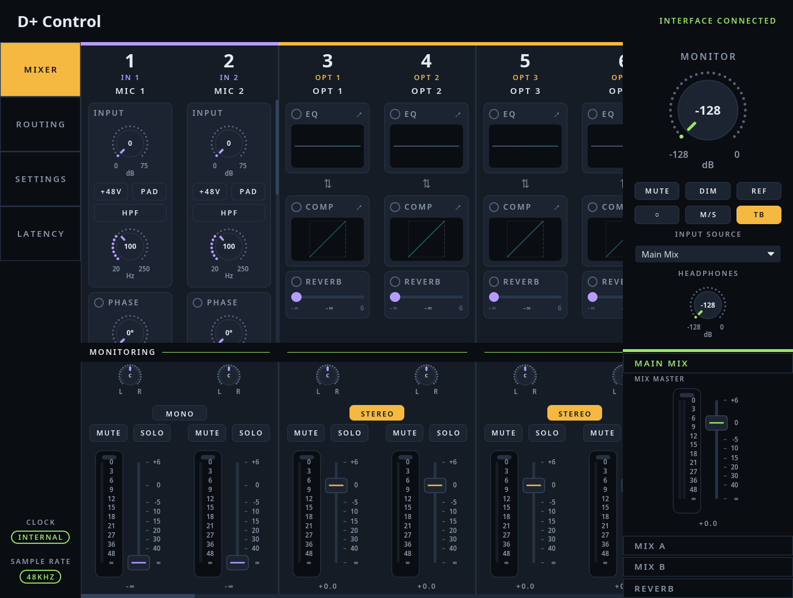
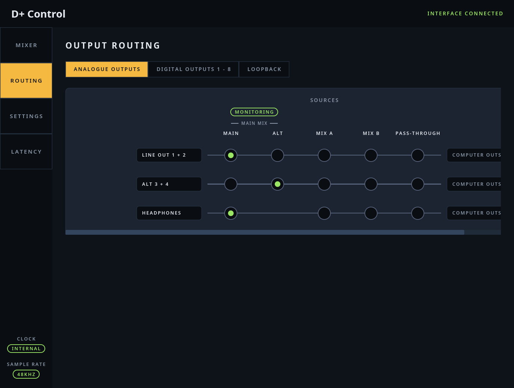
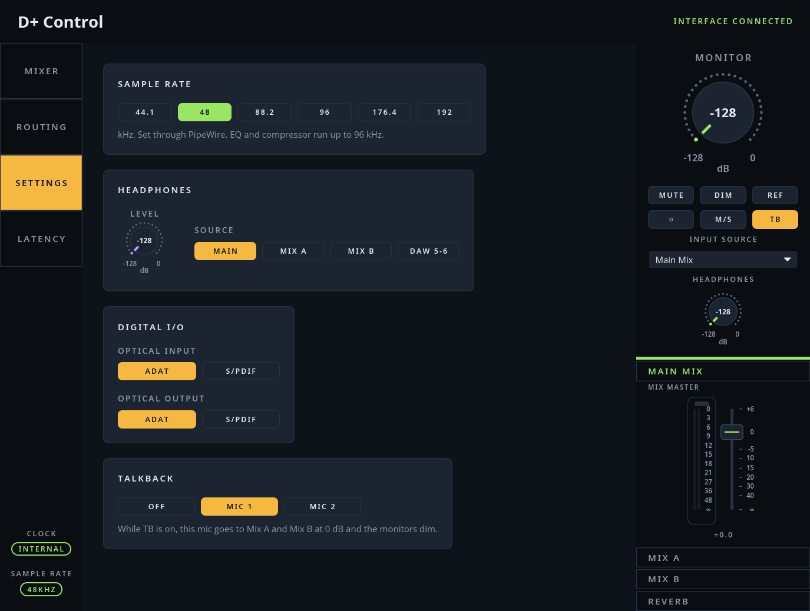
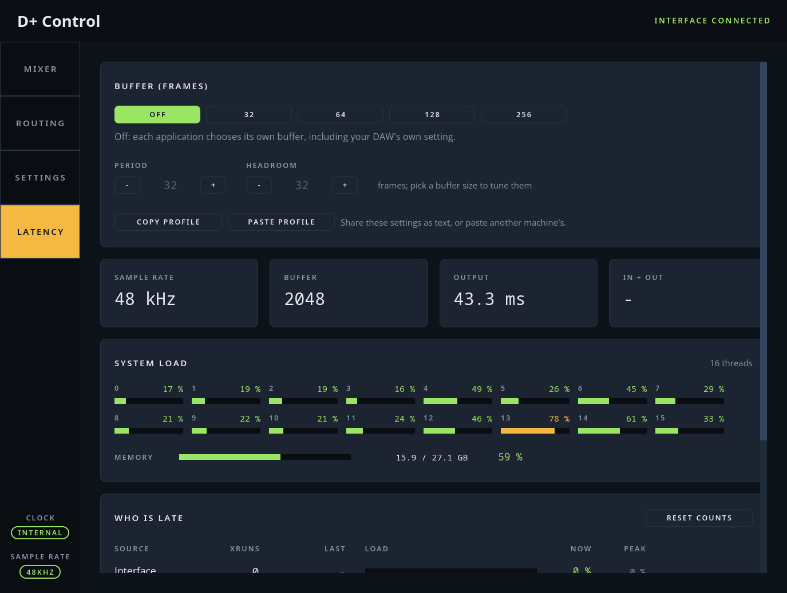

<p align="center"></p>

# D+ Control

A free, open-source control app for the Audient iD2+ audio interface on
Linux. It gives you the monitor controller, preamps, tone, the mixer and
reverb, and a Latency page that helps you get clean, low-latency audio out
of the interface under PipeWire.



## Why this exists

Audient does not make control software for Linux. The iD2+ works as a
class-compliant USB audio device, but without their app there is no way to
reach the mixer, the preamp switches or the routing. I built this so that I
could use my own interface, and I am sharing it for anyone else in the same
position. It is free, open source (MIT) and comes with no warranty.

It is an independent project. It is not made, endorsed or supported by
Audient. Audient and iD are trademarks of Audient Ltd.

## Features

- **Monitor:** volume, mute, dim, reference level, mono, M/S, talkback,
  input source and headphone level.
- **Preamps:** gain, +48V, pad, high-pass filter with adjustable cutoff.
- **Tone:** a Warm key, two tone switches (Tone A and B) and three input
  modes, and Phase on the mic inputs.
- **Channel DSP:** a four-band EQ (low shelf, two peaks, high shelf) with a
  draggable graph, and a compressor with threshold, ratio, attack, release,
  makeup and a gain-reduction meter. Swap the EQ/compressor order per
  channel. The DSP runs at sample rates up to 96 kHz.
- **Mixer:** 26 channels (2 mic, 8 optical, 14 DAW, reverb return) into
  Main, Mix A and Mix B, with level, pan, mute, solo, stereo link and meters.
- **Reverb:** a send on each channel, plus decay, damping and blend
  on the return strip.
- **Routing:** choose the source for each output pair.
- **Settings:** sample rate (through PipeWire), headphone level and source,
  optical input and output mode (ADAT or S/PDIF), and talkback.
- **Two-way:** changes made on the hardware show up in the app.
- **Latency:** see below.

| Routing | Settings |
|---|---|
|  |  |

## The Latency page

Low buffers are where a USB interface on Linux tends to glitch. The Latency
page shows what the audio graph is doing and lets you change the buffer.



- **Who is late:** xruns and load, split between the interface and each
  application, so you can tell whether the device or an app is at fault.
  Streams that only listen (level meters and visualisers) are marked, and
  are not counted against you.
- **System load:** every CPU thread and memory, in a fixed grid so nothing
  jumps around.
- **Buffer:** Off, 32, 64, 128 or 256 frames, each with its own period and
  headroom that you can adjust. Off hands the buffer back to your
  applications, including your DAW's own setting. While a size is on, it
  applies to every application and overrides the DAW's.
- **Profiles:** Copy profile puts your settings on the clipboard as text;
  Paste profile reads another machine's. Your settings are kept between
  runs.
- **Safe to close:** the app sets the buffer through PipeWire's own tools
  and never edits ALSA or PipeWire config files. It puts back what it found
  when you press Off or close the window, and does so on the next start if
  it was killed while a buffer was on.

It needs PipeWire with its command-line tools (`pw-top`, `pw-dump`,
`pw-cli`, `pw-metadata`) and `stdbuf` from coreutils. Without PipeWire the
page says its tools are not answering and the rest of the app works as
normal.

## Install

### Prebuilt release

Download `idctl-<version>-linux-x86_64.tar.gz` and its `SHA256SUMS` from the
[releases page](https://github.com/Kerf-Audio/idctl/releases), then:

```sh
sha256sum -c SHA256SUMS
tar -xzf idctl-*-linux-x86_64.tar.gz
cd idctl-*-linux-x86_64
./install.sh --udev
```

That installs the app, its icon and an app-list entry under `~/.local`, and
the device rule that lets your user open the interface (it asks for your
password). Replug the interface afterwards. It is built on Debian 12, so it
needs glibc 2.35 or newer (Ubuntu 22.04 and later, Debian 12 and later,
current Fedora and Arch), plus `libusb-1.0` and `libudev`. `./uninstall.sh
--udev` removes it. If it does not start on your system, build from source.

### Build from source

You need Rust 1.90 or newer and the development files for libusb, libudev,
xkbcommon and Wayland or X11. For example:

```sh
# Debian and Ubuntu
sudo apt install build-essential pkg-config libusb-1.0-0-dev libudev-dev \
    libxkbcommon-dev libwayland-dev libx11-dev librsvg2-bin

# Arch
sudo pacman -S --needed base-devel libusb libxkbcommon wayland librsvg

# Fedora
sudo dnf install gcc pkgconf-pkg-config libusb1-devel systemd-devel \
    libxkbcommon-devel wayland-devel librsvg2-tools
```

Then build and install it for your user, with the icon and an app-list
entry:

```sh
git clone https://github.com/Kerf-Audio/idctl
cd idctl
packaging/install-local.sh
```

The install goes under `~/.local` (set `PREFIX` to change that). Make sure
`~/.local/bin` is on your `PATH`. To build without installing, run
`cargo build --release`; the binary is `target/release/idctl-gui`.

### Let your user open the device

Without this rule only root can talk to the interface:

```sh
sudo cp packaging/70-id2plus.rules /etc/udev/rules.d/
sudo udevadm control --reload
sudo udevadm trigger
```

Replug the interface after installing the rule.

### Run it

Start **D+ Control** from your app list, or run `idctl-gui`. The corner of the
window says when the iD2+ is connected.

## Known issues

- Tested only on an iD2+ (USB `2708:0016`), on one machine: Arch Linux,
  Hyprland, PipeWire 1.6. Other setups may behave differently. Please open an
  issue and say what you have.
- Not implemented yet: polarity, record effects, auto gain and clock source. The
  FN button on the interface is not assigned to anything.
- The sample rate is changed through PipeWire only.
- The EQ and compressor run up to 96 kHz, not at 176.4 or 192 kHz.
- Monitor and headphone level changes are not ramped and there is no output
  ceiling. A fader moved quickly can click, and a large step can be loud, so
  keep headphones off your head when you try something new.
- The Latency page is new. Its test run, per-machine profile suggestions,
  Keep and Revert, a system check and the silent stress test are not built
  yet. Profiles are copied and pasted by hand for now.
- "In + out" on the Latency page needs a card profile that has an input.
- It needs PipeWire for everything on the Latency page; PulseAudio-only
  systems are not supported.

## Layout

| Crate | Job |
|---|---|
| `idctl-protocol` | Parameter map and value encodings. No I/O. |
| `idctl-usb` | Vendor control transfers over `rusb`. |
| `idctl-audio` | Reads and sets the PipeWire graph: xruns, load, buffer, profiles. |
| `idctl-gui` | The [iced](https://iced.rs) app. |

## Safety

The app writes to the interface only when you move a control. Take care
with +48V and with monitor and headphone levels.

## Licence

MIT. See [LICENSE](LICENSE).
